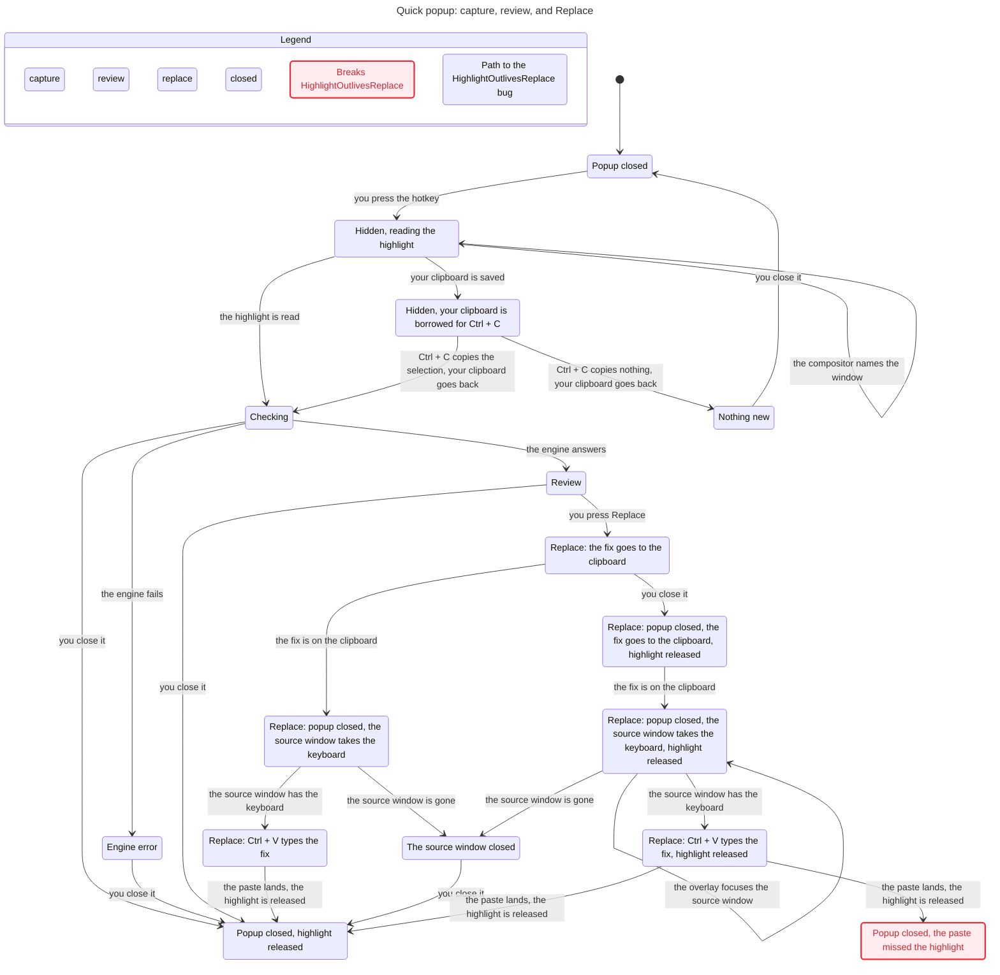

## State chart

This chart shows the quick popup run that this PR puts under verification: the capture, the review, Copy, and Replace.
TLC drew it from a scratch copy of `QuickRun.tla` with one summon, no Clear, and no focus change by you (366 states).
The full check uses three summons and one Clear.

What the chart shows:

- "Hidden, reading the highlight" and "Hidden, your clipboard is borrowed for Ctrl + C" are the capture of spec section 3.
  The popup stays hidden until the capture ends, and the borrowed clipboard goes back on each path out.
- "Replace: popup closed, the source window takes the keyboard" is the wait of the Apply table in spec section 6.
  Ctrl + V types only after the compositor names the source window, and the highlight is released after the paste.
- The red state breaks `HighlightOutlivesReplace`, a recorded finding.
  You press Replace, and you close the popup before `wl-copy` ends.
  The close releases the highlight, and the paste lands with no highlight to replace.

The chart does not draw steps that stay in one chart state, such as Ctrl + C, the 150 ms wait, and the clipboard restore.
It does not draw Copy, because Copy stays in "Review".
The two findings about the clipboard and the release need three summons, so this chart does not show them.

Covered digest: `028bf9b3b6302479a4f3458910a69dc299a5f54939148e148b9df94236110a15`
